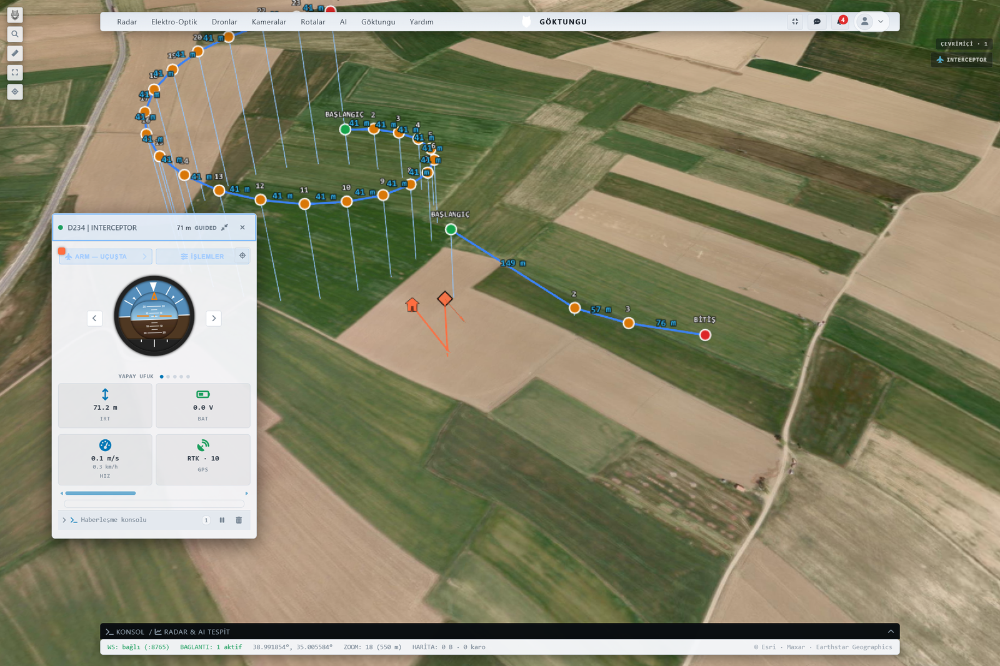

# GÖKTUNGU

GÖKTUNGU, dron komuta-kontrol ekosistemidir: yer kontrol istasyonu, çevrimiçi ve çevrimdışı merkez yazılımı, saha köprüleri, kurumsal/yönetim panelleri ve tanıtım sitesi. Bu depo, sistemin **kaynak ve mühendislik teslimidir**.

> **Bu depo özeldir (private).** İçinde sır, özel anahtar, parola, canlı veritabanı dökümü veya müşteri verisi **bulunmaz** — bunlar `.gitignore` ile dışarıda tutulur ve işletim ortamında güvenli biçimde yönetilir. Üretilen kurulum paketleri ve büyük model dosyaları depoda değil, **Releases** altındadır.

## Ürünler

| Kod | Ad | İşlev | Kaynak |
|---|---|---|---|
| **GRCOFF** | Offline Merkez | İnternetsiz/yerel merkez; yerel kamera ve **yerel AI** (kendi içinde AI sunucusu) | `01_GRCOFF/KAYNAK/` |
| **GRCON** | Online Sunucu | Merkezi web, katalog, lisans, güncelleme ve PostgreSQL veri katmanı | `02_GRCON/` |
| **BRDIMG** | Görüntü Köprüsü | Saha görüntü kaynağı/işleme köprüsü (AI Görüntü Köprüsü) | `03_BRDIMG/ORTAK_KOPRU_KAYNAGI/` |
| **BRDTLM** | Telemetri/Radar Köprüsü | Telemetri ve radar bağlantı köprüsü (BRDIMG ile ortak çekirdek) | `04_BRDTLM/` |
| **BRDAND** | Android Köprü | Android MAVLink telemetri köprüsü | `05_BRDAND/KAYNAK/` |
| **BRDDJI** | Android DJI | Android DJI köprüsü | `06_BRDDJI/KAYNAK/` |
| **GRCCMP** | Kurumsal/Müşteri Paneli | Lisanslı müşteri, paket ve kurum yüzü | `07_GRCCMP/KAYNAK/` |
| **GRCADM** | Yönetim Paneli | Operasyon ve katalog yönetimi | `08_GRCADM/KAYNAK/` |
| **GRCWEB** | Tanıtım Sitesi | Açık tanıtım, yardım ve yasal sayfalar | `09_GRCWEB/KAYNAK/` |

Bu ürün kodları dosya, klasör, sürüm notu ve teknik iletişimde değişmeden kullanılır.

## Mimari özeti

- **GRCON — çevrimiçi merkez.** Üretimde `goktungu-merkez` ve `goktungu-app` servisleri çalışır. Web arayüzünü, kurumsal/yönetim panellerini, sürüm kataloğunu, lisanslı paket teslimini, güncelleme ucunu ve PostgreSQL verisini sağlar. AI işini **Görüntü Köprüsünde (BRDIMG)** yapar; kendi içinde yerel AI işçisi çalıştırmaz.
- **GRCOFF — çevrimdışı merkez.** Kendi makinesinde çalışır; **köprü gerektirmeden** yerel kamera, görüntüleme ve **yerel AI** çalıştırır. Merkez'in kendisi aynı zamanda AI sunucusudur: yerel AI işçisi Merkez ile birlikte başlar ve canlı görüntüye AI'ı doğrudan uygular (İnsan, Kara Aracı, Hava Aracı tespiti).
- **BRDIMG + BRDTLM** ortak köprü çekirdeğini paylaşır; birindeki değişiklik diğerinde regresyon riski taşır.
- **GRCCMP / GRCADM / GRCWEB** aynı web ağacından ayrıştırılmış yüzlerdir; ortak CSS/JS bağımlılıklarına dikkat edin.

Ayrıntı: [`13_DOKUMANTASYON/SISTEM_DEVIR_REHBERI.md`](13_DOKUMANTASYON/SISTEM_DEVIR_REHBERI.md).

## Sürümler

- **Uygulama sürümü** (GRCOFF arayüzü) tek kaynak: `01_GRCOFF/KAYNAK/js/surum.js` → `GCS_SURUM`. Değişiklik geçmişi (`GCS_SURUM_GECMISI`) aynı dosyadadır.
- **Paket sürümü** (katalog) uygulamadan ayrıdır ve `01_GRCOFF/KAYNAK/goktungu/paket_surum.py` içinde tektir (`PAKET_SURUM`, `UYGULAMA_SURUM`). `main.py` ve iki build betiği bu dosyadan okur.
- Güncel: **paket 2.5.126 / uygulama 2.4.256.** Sürüm notları: [`13_DOKUMANTASYON/SURUM_NOTLARI.md`](13_DOKUMANTASYON/SURUM_NOTLARI.md).
- **Sürüm kapısı:** `js/surum.js` (`GCS_SURUM`) + `goktungu/__init__.py` (`_SON_BILINEN`) + `goktungu/paket_surum.py` birlikte artar; build betikleri eşleşmezse durur. Ayrıntı: [`13_DOKUMANTASYON/DERLEME.md`](13_DOKUMANTASYON/DERLEME.md).

## Kurulum, derleme ve yayın

- **Kurulum** (Windows/Ubuntu, PostgreSQL sihirbazı, lisans belgesi, yerel AI, otomatik güncelleme): [`13_DOKUMANTASYON/KURULUM.md`](13_DOKUMANTASYON/KURULUM.md)
- **Derleme** (`.deb` + `.exe`, konteyner içinde): [`13_DOKUMANTASYON/DERLEME.md`](13_DOKUMANTASYON/DERLEME.md)
- **Yayın** (katalog, Ed25519 imza, güncelleme ucu): [`13_DOKUMANTASYON/YAYIN.md`](13_DOKUMANTASYON/YAYIN.md)
- **Makro API** (dron Python makroları; makro yazan yapay zekâ için sözleşme): [`13_DOKUMANTASYON/MAKRO_API.md`](13_DOKUMANTASYON/MAKRO_API.md)

## Ajanlar için

Kaynakta çalışan yazılım ajanları için kurallar: [`AGENTS.md`](AGENTS.md), [`CLAUDE_CODE.md`](CLAUDE_CODE.md), [`GEMINI.md`](GEMINI.md). Özet: değişiklikleri küçük ve geri alınabilir tutun; ürün sınırlarını koruyun (GRCOFF'a ait yerel kamera/AI yüzeyi GRCON'a taşınmaz); derleme/sözdizim denetimlerini ve testleri çalıştırın; sır ve çalışma verisini depoya eklemeyin.
